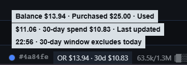

# openrouter-balance

A Hermes status bar chip that shows your OpenRouter money at a glance:

```
OR $41.20 · 30d $8.80
```

- **Balance** — remaining prepaid credit (`total_credits − total_usage`).
- **30d** — spend over the last 30 completed UTC days. Today is excluded.

Click the chip to open `https://openrouter.ai/activity` in your browser.
Hover for a tooltip: balance, lifetime purchased, lifetime used, 30-day
spend, last-updated time, and any refresh error.



## How it works

| Part | File | Role |
|---|---|---|
| Backend | `dashboard/plugin_api.py` | Python (stdlib only). Calls OpenRouter `/credits` and `/activity` with a **management key**, serves `GET /summary` at `/api/plugins/openrouter-balance/summary`. 60 s cache. |
| Desktop | `desktop/plugin.js` | Polls `/summary` every 5 min through React Query. Renders the chip in `statusBar.right`. |
| Agent stub | `__init__.py` + `plugin.yaml` | Registers nothing agent-side; `plugin.yaml` carries the `plugins.enabled` gate. |

- The management key never reaches the renderer. The backend reads it from
  `.env` only, and never logs it.
- On failure the chip keeps its last values and dims. Errors land in host
  logs, not toasts.
- `byok_usage` (bring-your-own-key credit) is excluded from both numbers.

## Setup

### 1. Create a management key

Go to [openrouter.ai/keys](https://openrouter.ai/keys) and create a new
key. Pick the **management** type. Use a dedicated key for this plugin —
do not reuse your inference key. A normal usage key gets HTTP 403 from the
plugin's endpoints.

### 2. Put the key in the Hermes `.env`

Add one line to `C:\Users\<you>\AppData\Local\hermes\.env`:

```
OPENROUTER_MANAGEMENT_KEY=sk-or-v1-...
```

Profiles without their own `.env` key fall back to this root file, so one
key serves the whole desktop app. Restart the desktop app after adding it.

### 3. Enable the backend

Enable the backend by setting the full plugin list as JSON. Passing a bare
name **replaces** the whole list with a string — always include every
plugin you already have:

```bash
hermes config set plugins.enabled '["openrouter-balance"]'
```

Check with:

```bash
hermes config get plugins.enabled
# - openrouter-balance
```

This gate mounts the Python backend on the dashboard web server.

### 4. Enable the desktop chip

Open the Hermes desktop app → **Settings → Plugins** → toggle
**OpenRouter Balance** on. The desktop half ships disabled by default
(`defaultEnabled: false`), matching the backend gate.

If the chip does not appear: ⌘K → **Reload desktop plugins**. Both gates
are required — a missing one is the classic "plugin not appearing" trap.

### 5. Verify

The chip shows `OR $<balance> · 30d $<spend>` within seconds. Compare
against the [OpenRouter dashboard](https://openrouter.ai/credits); the
30-day figure excludes today (completed UTC days only).

Manual check of the backend:

```bash
curl -s http://127.0.0.1:8787/api/plugins/openrouter-balance/summary
```

`8787` is the dashboard port; substitute yours if different. Success
returns:

```json
{
  "balance": 41.2,
  "total_credits": 50.0,
  "total_usage": 8.8,
  "spend_30d": 8.8,
  "window": { "start": "2026-07-30", "end": "2026-08-28", "excludes_today": true },
  "fetched_at": "2026-08-29T14:03:11Z"
}
```

Errors: HTTP 502 with `{"error": ..., "status": ...}` when OpenRouter
fails, 503 when the key is missing.

## Configuration

| Setting | Where | Default |
|---|---|---|
| Poll interval | `REFRESH_INTERVAL_MS` constant at the top of `desktop/plugin.js` | 300 000 ms (5 min) |
| Click target | `ACTIVITY_URL` in `desktop/plugin.js` | openrouter.ai/activity |

Edit the constant, save — the desktop app hot-reloads the file.

## Layout

```
openrouter-balance/
├── plugin.yaml
├── __init__.py
├── README.md
├── dashboard/
│   ├── manifest.json
│   └── plugin_api.py
├── desktop/
│   └── plugin.js
└── tests/
    ├── hash_check_backend.py   # deployed copies match the repo (sha256)
    ├── launch_modes.py         # spawn all 4 verification servers
    ├── run_mode.py             # single-mode server (success|nokey|e401|down)
    ├── logs/                   # gitignored test output
    └── nokey_home/             # gitignored empty HERMES_HOME fixture
```

## Tests

The backend was verified in four modes. From the repo root
(`hermes-plugins/`):

```bash
cd plugins/openrouter-balance/tests
python launch_modes.py check    # spawn + curl all four modes
python launch_modes.py stop     # kill the servers when done
```

Expected: `success` → HTTP 200 with the contract JSON (needs a real key in
`.env`), `nokey` → 503, `e401` → 502 with "Invalid management key",
`down` → 502 with "OpenRouter unreachable".

`hash_check_backend.py` compares every deployed `plugin_api.py` against
the repo copy by SHA-256. Run it after deploying an update.

## Deploying an update

1. Edit the plugin under `plugins/openrouter-balance/` in this repo.
2. Copy the folder over the live copy:

   ```bash
   cp -r plugins/openrouter-balance "$LOCALAPPDATA/hermes/plugins/"
   ```

3. Run `tests/hash_check_backend.py` or re-run the mode rig.
4. Restart the desktop app or ⌘K → **Reload desktop plugins** for the
   desktop half; the Python backend reloads with the app.

## Design notes

The full spec lives at [`specs/openrouter-balance-plugin.md`](../../specs/openrouter-balance-plugin.md):
data sources, locked decisions, requirements, and acceptance criteria.
Short version: OpenRouter management keys can create and destroy API keys,
so the key stays in `.env` on the Python side (Option B in the spec) and
never enters the Electron renderer.
